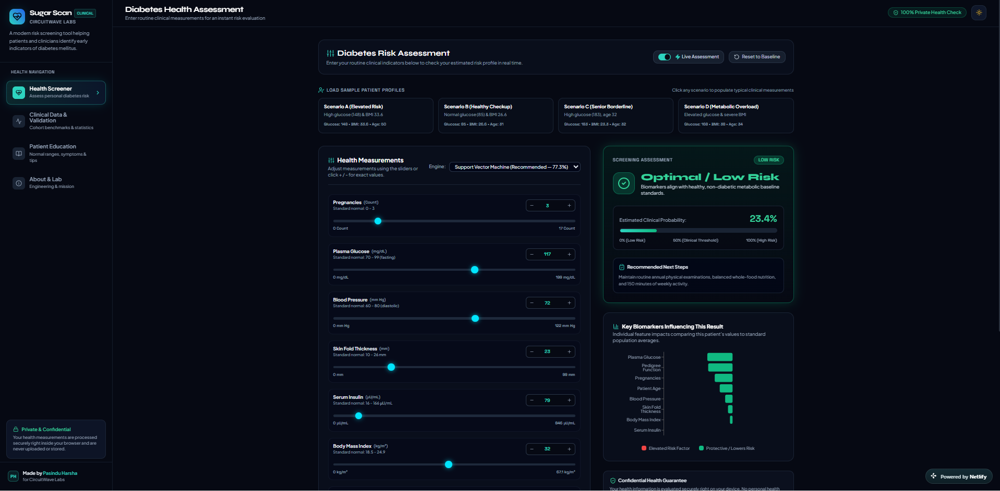
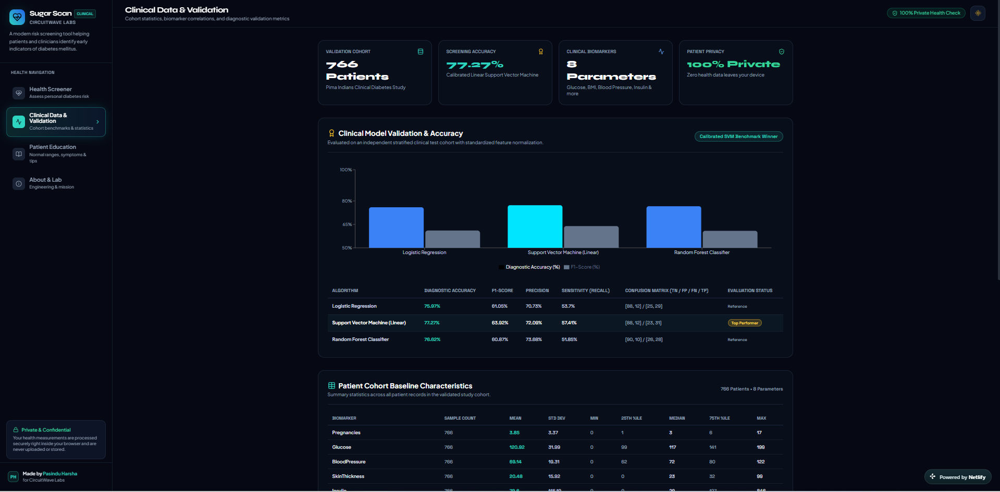
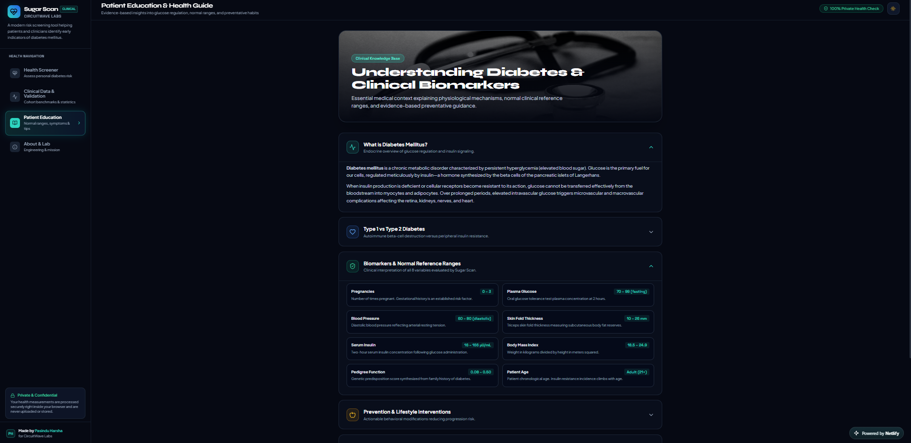
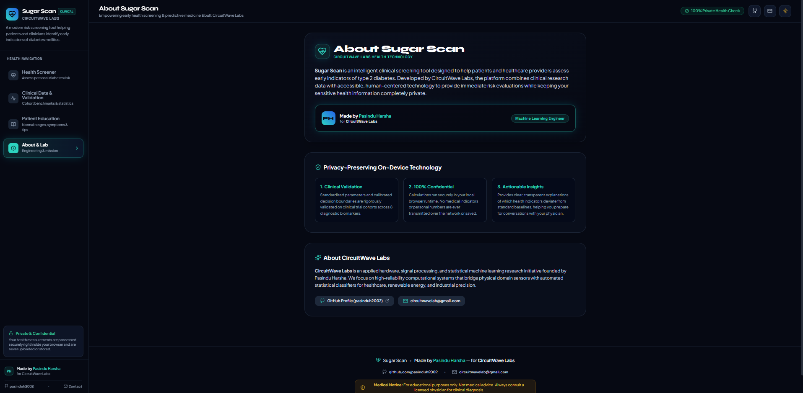
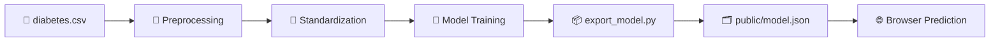
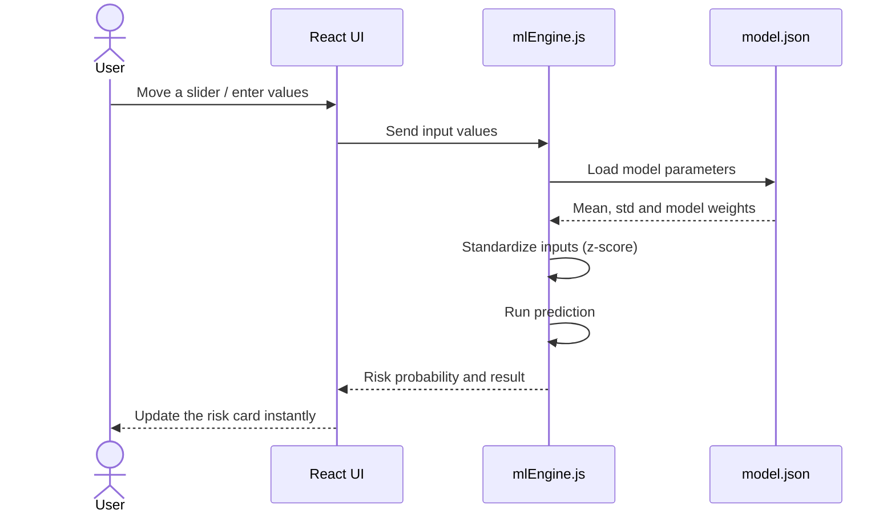

<div align="center">

<br/>


 
-00c2d1?style=flat-square)


 
<br/> 
### 🌐 [Try the Live Demo →](https://sugar-scan-five.vercel.app/)
 
<sub>No sign-up • No backend • No data leaves your device</sub>
 
<br/>
[**About**](#-about) •
[**App Tour**](#-app-tour) •
[**Features**](#-features) •
[**How It Works**](#-how-it-works) •
[**Evaluation**](#-model-evaluation) •
[**Setup**](#-getting-started) •
[**FAQ**](#-faq)
 
</div>
<br/>
---
 
## 📖 Table of Contents
 
<details>
<summary><b>Click to expand</b></summary>
<br/>
1. [About](#-about)
2. [App Tour](#-app-tour)
3. [Features](#-features)
4. [Why Client-Side](#-why-client-side)
5. [How It Works](#-how-it-works)
6. [Input Features](#-input-features)
7. [Model Evaluation](#-model-evaluation)
8. [Tech Stack](#️-tech-stack)
9. [Getting Started](#-getting-started)
10. [Deployment](#-deployment)
11. [Privacy Design](#-privacy-design)
12. [Project Structure](#-project-structure)
13. [Roadmap](#️-roadmap)
14. [FAQ](#-faq)
15. [Troubleshooting](#-troubleshooting)
16. [Contributing](#-contributing)
17. [Developer](#-developer)
18. [Disclaimer](#️-disclaimer)
19. [License](#-license)
</details>
<br/>
---
 
## ✨ About
 
**Sugar Scan** is a modern diabetes risk screening tool that estimates risk from eight routine health measurements, using a machine learning model that runs **entirely inside your browser**.
 
It is trained on the **Pima Indians clinical diabetes dataset** (766 patient records, 8 parameters). The model is trained in Python, exported to a small `model.json` file, and executed on the client with JavaScript. Predictions are instant, and nothing you enter is ever uploaded or stored.
 
<br/>
## 🖼️ App Tour
 
### 🩺 Health Screener
 
Adjust eight health measurements with sliders or exact values and watch the risk estimate update live. Pick a model engine, load a sample patient profile, and see which biomarkers drive the result.
 
<div align="center">

</div>
<br/>
- **Live Assessment** toggle for real-time results as you move a slider
- **Sample patient profiles** (Scenarios A to D) that fill in typical values with one click
- **Engine selector** to switch between Logistic Regression, SVM and Random Forest
- **Risk card** with estimated probability and recommended next steps
- **Key biomarker chart** showing which inputs raise or lower the risk
<br/>
### 📈 Clinical Data & Validation
 
The numbers behind the model: cohort size, accuracy, an algorithm comparison chart, a full metrics table with confusion matrices, and baseline statistics for every biomarker.
 
<div align="center">

</div>
<br/>
### 📚 Patient Education
 
A built-in knowledge base that explains diabetes, the difference between Type 1 and Type 2, normal reference ranges for all eight biomarkers, and lifestyle prevention tips.
 
<div align="center">

</div>
<br/>
### 🧪 About & Lab
 
The story behind the project, its privacy approach, and CircuitWave Labs.
 
<div align="center">

</div>
<br/>
## 🚀 Features
 
<table>
  <tr>
    <td align="center" width="25%">
      <h3>🧠</h3>
      <b>ML Prediction</b><br/>
      <sub>Diabetes risk estimated by a trained machine learning model</sub>
    </td>
    <td align="center" width="25%">
      <h3>⚡</h3>
      <b>Live Assessment</b><br/>
      <sub>Results update instantly as you move a slider</sub>
    </td>
    <td align="center" width="25%">
      <h3>🔒</h3>
      <b>Privacy First</b><br/>
      <sub>Your data never leaves your device</sub>
    </td>
    <td align="center" width="25%">
      <h3>🎛️</h3>
      <b>Choose Your Engine</b><br/>
      <sub>Switch between Logistic Regression, SVM and Random Forest</sub>
    </td>
  </tr>
  <tr>
    <td align="center">
      <h3>👤</h3>
      <b>Sample Patients</b><br/>
      <sub>One-click scenarios to explore the tool</sub>
    </td>
    <td align="center">
      <h3>📊</h3>
      <b>Explainable Results</b><br/>
      <sub>See which biomarkers raise or lower the risk</sub>
    </td>
    <td align="center">
      <h3>📚</h3>
      <b>Built-in Education</b><br/>
      <sub>Reference ranges, symptoms and prevention tips</sub>
    </td>
    <td align="center">
      <h3>🌗</h3>
      <b>Light & Dark Theme</b><br/>
      <sub>Switch themes with one click</sub>
    </td>
  </tr>
  <tr>
    <td align="center">
      <h3>📦</h3>
      <b>Tiny Model</b><br/>
      <sub>Exported as a lightweight <code>model.json</code></sub>
    </td>
    <td align="center">
      <h3>🔄</h3>
      <b>Easy Retraining</b><br/>
      <sub>One command regenerates the model</sub>
    </td>
    <td align="center">
      <h3>🚫</h3>
      <b>Zero Backend</b><br/>
      <sub>No server, database or API keys</sub>
    </td>
    <td align="center">
      <h3>🌍</h3>
      <b>Deploy Anywhere</b><br/>
      <sub>Static build works on Vercel, Netlify and more</sub>
    </td>
  </tr>
</table>
<br/>
## 🔐 Why Client-Side?
 
| | Traditional ML Web App | 🩺 Sugar Scan |
|---|---|---|
| **Where prediction runs** | On a remote server | In your browser |
| **Health data** | Sent over the network | Never leaves your device |
| **Backend needed** | Yes | No |
| **Database** | Usually | None |
| **Hosting cost** | Server + maintenance | Static hosting only |
| **Speed** | Network latency | Instant |
 
<br/>
## 🧠 How It Works
 
### Training pipeline
 

 
# What happens when you adjust a value
 

 
<details open>
<summary><b>1️⃣ Data Preprocessing</b></summary>
<br/>
- Dataset cleaning
- Handling input features
- Preparing data for training
</details>
<details open>
<summary><b>2️⃣ Feature Standardization</b></summary>
<br/>
Every input value is standardized before it reaches the model:
 
```text
z = (x − μ) / σ
```
 
| Symbol | Meaning |
|:---:|---|
| `x` | Input value |
| `μ` | Mean of the training data |
| `σ` | Standard deviation of the training data |
 
In code, that is simply:
 
```javascript
const standardize = (x, mean, std) => (x - mean) / std;
```
 
</details>
<details open>
<summary><b>3️⃣ Model Training</b></summary>
<br/>
The dataset is split using **stratified splitting**, so the diabetic / non-diabetic ratio stays the same in both sets.
 
| Split | Share |
|---|:---:|
| 🏋️ Training data | **80%** |
| 🧪 Testing data | **20%** |
 
Three models are compared: **Logistic Regression**, **Support Vector Machine (Linear)** and **Random Forest**. The calibrated linear SVM performs best and is the recommended engine in the app.
 
</details>
<details open>
<summary><b>4️⃣ Model Export</b></summary>
<br/>
Trained model parameters are exported with:
 
```bash
python export_model.py
```
 
Output: `public/model.json`
 
</details>
<br/>
## 🧾 Input Features
 
Sugar Scan uses **8 clinical parameters**, with the standard normal ranges shown in the app:
 
| Feature | Unit | Description | Standard normal range |
|---|:---:|---|:---:|
| **Pregnancies** | count | Number of times pregnant | 0 – 3 |
| **Plasma Glucose** | mg/dL | Plasma glucose concentration (oral glucose tolerance test) | 70 – 99 (fasting) |
| **Blood Pressure** | mm Hg | Diastolic blood pressure | 60 – 80 |
| **Skin Fold Thickness** | mm | Triceps skin fold thickness | 10 – 26 |
| **Serum Insulin** | µIU/mL | Two-hour serum insulin | 16 – 166 |
| **Body Mass Index** | kg/m² | Weight in kg divided by height in meters squared | 18.5 – 24.9 |
| **Diabetes Pedigree Function** | score | Genetic predisposition from family history | 0.08 – 0.50 |
| **Age** | years | Patient age | Adult (21+) |
 
<br/>
## 📊 Model Evaluation
 
Sugar Scan evaluates models with these metrics:
 
| Metric | What it tells you | Formula |
|---|---|---|
| 🎯 **Accuracy** | Overall prediction correctness | `(TP + TN) / (TP + TN + FP + FN)` |
| 🔬 **Precision** | Of the predicted diabetic cases, how many are truly diabetic | `TP / (TP + FP)` |
| 📡 **Recall** | Of the actual diabetic cases, how many were detected | `TP / (TP + FN)` |
| ⚖️ **F1 Score** | Balance between precision and recall | `2 × (P × R) / (P + R)` |
 
# 🏆 Results
 
Evaluated on an independent, stratified 20% test set (154 patients).
 
| Model | Accuracy | F1 Score | Precision | Recall | Status |
|---|:---:|:---:|:---:|:---:|:---:|
| Logistic Regression | 75.97% | 61.05% | 70.73% | 53.70% | Reference |
| **Support Vector Machine (Linear)** | **77.27%** | **63.92%** | **72.09%** | **57.41%** | 🏆 **Top performer** |
| Random Forest | 76.62% | 60.87% | 73.68% | 51.85% | Reference |
 
# Confusion Matrices
 
Each cell reads as TN, FP, FN, TP.
 
| Model | TN | FP | FN | TP |
|---|:---:|:---:|:---:|:---:|
| Logistic Regression | 88 | 12 | 25 | 29 |
| **Support Vector Machine (Linear)** | 88 | 12 | 23 | 31 |
| Random Forest | 90 | 10 | 26 | 28 |
 
How to read a confusion matrix:
 
|  | Predicted Diabetic | Predicted Non-Diabetic |
|---|:---:|:---:|
| **Actual Diabetic** | ✅ True Positive (TP) | ❌ False Negative (FN) |
| **Actual Non-Diabetic** | ❌ False Positive (FP) | ✅ True Negative (TN) |
 
<br/>
# 🛠️ Tech Stack
 
<table>
  <tr>
    <th>🖥️ Frontend</th>
    <th>🤖 Machine Learning</th>
    <th>☁️ Deployment</th>
  </tr>
  <tr>
    <td>React.js<br/>JavaScript<br/>HTML<br/>CSS</td>
    <td>Python<br/>Scikit-learn<br/>Pandas<br/>NumPy</td>
    <td>Vercel (live demo)<br/>Netlify-compatible static build</td>
  </tr>
</table>
<br/>
## 📦 Getting Started
 
**Requirements:** Node.js • npm • Python 3.x
 
```bash
# 1. Clone the repository
git clone https://github.com/pasinduh2002/sugar-scan.git
cd sugar-scan
 
# 2. Install dependencies
npm install
 
# 3. Run the app
npm run dev
```
 
Then open **http://localhost:5173** 🎉
 
<details>
<summary><b>🔄 Retrain the Machine Learning Model</b></summary>
<br/>
```bash
python export_model.py
```
 
This regenerates `public/model.json` from `diabetes.csv`. Refresh the app to use the new model.
 
</details>
<details>
<summary><b>🏭 Production Build</b></summary>
<br/>
```bash
npm run build
```
 
The optimized static site is written to `dist/`.
 
</details>
<br/>
## ☁️ Deployment
 
Sugar Scan is a static site, so deployment is simple.
 
<details>
<summary><b>▲ Vercel</b></summary>
<br/>
1. Push the project to GitHub.
2. Import the repo at [vercel.com](https://vercel.com).
3. Build command: `npm run build`
4. Output directory: `dist`
5. Click **Deploy**.
</details>
<details>
<summary><b>🟢 Netlify</b></summary>
<br/>
1. Push the project to GitHub.
2. Add a new site from Git at [netlify.com](https://www.netlify.com).
3. Build command: `npm run build`
4. Publish directory: `dist`
5. Click **Deploy site**.
</details>
<br/>
## 🔒 Privacy Design
 
Sugar Scan is built privacy-first:
 
| | |
|---|---|
| ✅ | Prediction happens in the browser |
| ✅ | No patient data upload |
| ✅ | No database storage |
| ✅ | No cloud API dependency |
 
<br/>
# 📁 Project Structure
 
```text
Sugar-Scan/
│
├── assets/                 # Banner, footer and screenshots
├── public/
│   └── model.json          # Exported model parameters
│
├── src/
│   ├── components/         # UI components
│   ├── utils/
│   │   └── mlEngine.js     # In-browser prediction engine
│   └── App.jsx             # Main application
│
├── diabetes.csv            # Training dataset
├── export_model.py         # Trains and exports the model
└── package.json
```
 
<br/>
# 🗺️ Roadmap
 
- [x] In-browser diabetes risk prediction
- [x] Privacy-first, no-backend design
- [x] Three selectable ML engines
- [x] Clinical validation dashboard
- [x] Patient education section
- [x] Light and dark theme
- [x] Live deployment
- [ ] Multi-language support
- [ ] Downloadable result summary
- [ ] Mobile-optimized layout improvements
<br/>
## ❓ FAQ
 
<details>
<summary><b>Is my data sent anywhere?</b></summary>
<br/>
No. The model runs in your browser, and nothing you enter is uploaded or stored.
 
</details>
<details>
<summary><b>Is Sugar Scan a medical diagnosis tool?</b></summary>
<br/>
No. It is an educational and research demo. Please talk to a doctor for any medical concern.
 
</details>
<details>
<summary><b>Which model is the most accurate?</b></summary>
<br/>
The calibrated linear Support Vector Machine, at 77.27% accuracy on the test set. It is the recommended engine in the app.
 
</details>
<details>
<summary><b>Do I need Python to run the website?</b></summary>
<br/>
No. Python is only needed if you want to retrain the model. The website only needs Node.js.
 
</details>
<details>
<summary><b>How do I use my own dataset?</b></summary>
<br/>
Replace `diabetes.csv`, run `python export_model.py`, and the new `public/model.json` is picked up by the app.
 
</details>
<br/>
## 🧯 Troubleshooting
 
| Problem | Fix |
|---|---|
| `npm: command not found` | Install [Node.js](https://nodejs.org/) |
| Port 5173 already in use | Stop the other app, or Vite will offer another port |
| Prediction not working | Make sure `public/model.json` exists, then run `python export_model.py` |
| `ModuleNotFoundError` in Python | Run `pip install pandas numpy scikit-learn` |
| README images not showing | Check that the files exist in `assets/` with the exact names used here |
 
<br/>
# 🤝 Contributing
 
Contributions, ideas and bug reports are welcome.
 
1. Fork the repository
2. Create a branch: `git checkout -b feature/your-feature`
3. Commit your changes: `git commit -m "Add your feature"`
4. Push: `git push origin feature/your-feature`
5. Open a Pull Request
<br/>
# 👨‍💻 Developer
 
<div align="center">
Pasindu Harsha
Electronic & Telecommunication Engineering Undergraduate
Machine Learning Engineer • Founder / Developer, CircuitWave Labs
 
[](https://github.com/pasinduh2002)
[](mailto:circuitwavelab@gmail.com)
 
</div>
<br/>
 ⚠️ Disclaimer
 
> **Medical Notice:** Sugar Scan is built for **educational purposes, research demonstrations, and machine learning portfolio projects**.
> It is **not a medical diagnostic system** and should not replace professional medical advice. Always consult a licensed physician for clinical diagnosis.
 
<br/>
# 📜 License
 
© CircuitWave Labs
 
<br/>
<div align="center">
⭐ If you like this project, give it a star! ⭐
 

</div>
 
